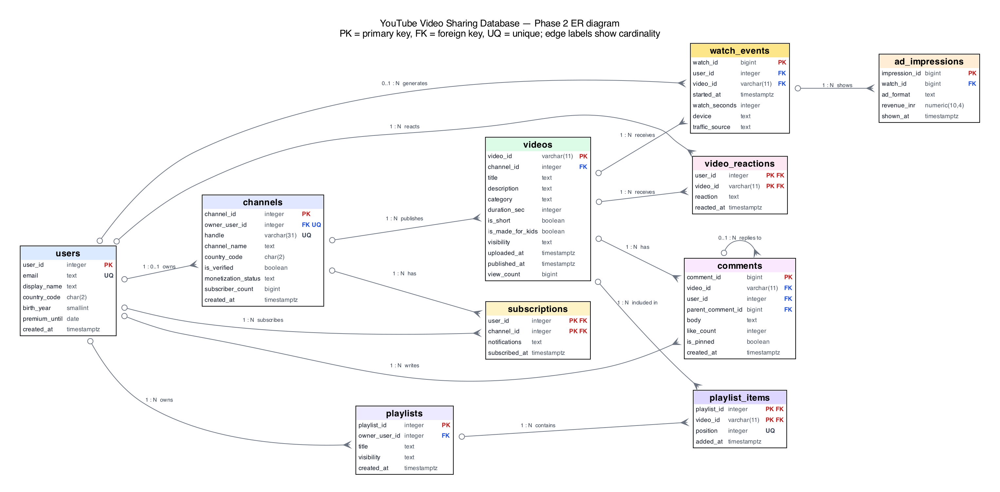
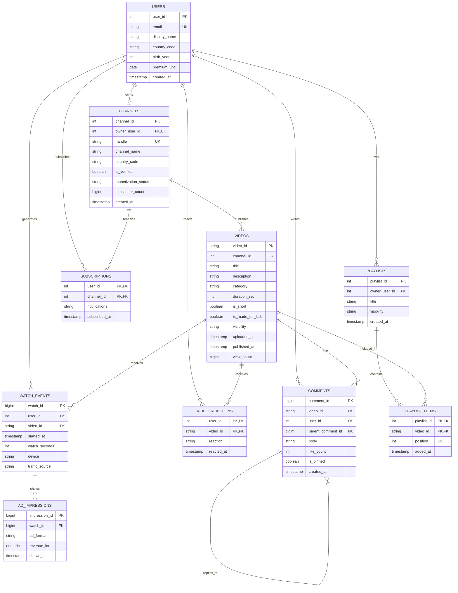

# Phase 2 — Schema Design and Data Load

**Team:** T0046 · Section A · Group Lead: Saksham Kachhawaha
**Phase owner:** Arnav Bansal (2501010643, `arnavbansal12`)
**Database:** PostgreSQL 15.18 (validated locally; the project requires PostgreSQL 15+)
**Input:** the ten CSV exports in `seed_data.zip`
**Deliverables:** `sql/01_schema.sql`, `sql/02_load_data.sql`, this document, `diagrams/er_diagram.png`

## 1. Summary

The schema was reverse-engineered from the ten CSV headers and their values, not from a supplied DDL. It contains ten tables in the `youtube` schema, with exactly the table and column names used by `queries/workload_30.sql`. All ten files load with zero errors and the row counts match the README exactly. All 30 workload queries execute against the loaded schema; the five write queries were run inside the file's `BEGIN … ROLLBACK` wrapper, so the data was not changed.

Phase 2 intentionally contains **no indexes beyond those PostgreSQL creates automatically for PRIMARY KEY and UNIQUE constraints**. This keeps the Phase 3 baseline honest: it measures the schema before any tuning.

The most important design decisions are:

1. `video_id` is an 11-character **string**, not a number.
2. `subscriptions`, `video_reactions` and `playlist_items` use **composite keys**; `playlist_items` has two candidate keys.
3. `watch_events.user_id` is nullable because 49,964 views are logged out.
4. `videos.published_at` is nullable **only** for private videos; scheduled videos already carry a future publish time.
5. Money is `numeric(10,4)`, timestamps are `timestamptz`, and every exported timestamp carries `+05:30`.
6. The three derived/denormalized columns (`channels.subscriber_count`, `videos.view_count`, `videos.is_short`) are kept for read performance, with their risks documented in §6.3.
7. Delete rules protect ownership, content and revenue history with `RESTRICT`; child rows use `CASCADE`; `watch_events.user_id` uses `SET NULL` to keep anonymous aggregate statistics.

## 2. Design principles

- **Exact names.** The workload is fixed and unmodifiable. A rename such as `watch_seconds` → `seconds_watched` would break Phase 3.
- **Right type, not `TEXT` everywhere.** `timestamptz` preserves the `+05:30` offset; `numeric(10,4)` preserves four-decimal INR revenue; `boolean` represents `t`/`f`; `varchar(11)` represents the 11-character video ID; `smallint` is enough for a birth year.
- **Constraints at the right layer.** PK/FK/UNIQUE/NOT NULL/CHECK are used in Phase 2. Cross-table rules, such as “a watch cannot be longer than its video”, cannot be a PostgreSQL `CHECK`; they are verified as integrity-check queries instead.
- **No hidden tuning.** No extra indexes, no materialized views, no server-setting tricks. The baseline must show the untuned behaviour.
- **Data problems are reported, not deleted.** The CSVs are the production export. If the data violates a business rule, the report says so; the schema does not silently drop rows.

## 3. ER diagram



The PNG is generated from `diagrams/er_diagram.dot` with Graphviz. The same model is written as Mermaid below so it can be edited or rendered in a Markdown viewer.

### 3.1 Mermaid source



### 3.2 Cardinalities

| Relationship | Cardinality | Meaning |
|---|---|---|
| users → channels | 1 : 0..1 | A signed-in user may own at most one channel; a channel has exactly one owner. The export has 3,000 distinct owners for 3,000 channels. |
| channels → videos | 1 : N | A channel publishes many videos; every video belongs to one channel. |
| users ↔ subscriptions ↔ channels | M : N | `subscriptions` resolves the many-to-many relationship; its PK is `(user_id, channel_id)`. |
| users → watch_events | 0..1 : N | A user can generate many views; a view may have no user because it is logged out. |
| videos → watch_events | 1 : N | A video receives many views; every view names exactly one video. |
| users ↔ video_reactions ↔ videos | M : N | `video_reactions` allows one reaction per user per video. |
| users → comments | 1 : N | A user writes many comments; every comment has one author. |
| videos → comments | 1 : N | A video has many comments; every comment belongs to one video. |
| comments → comments | 0..1 : N | `parent_comment_id` is a self-reference; top-level comments have `NULL`, replies point to a parent. |
| users → playlists | 1 : N | A user owns many playlists. |
| playlists ↔ playlist_items ↔ videos | M : N | `playlist_items` puts videos into playlists in a position order. |
| watch_events → ad_impressions | 1 : N | A watch can show one or more ads (in the export, one or two). |

## 4. Data dictionary

`Null?` = “yes” means the column is nullable. All timestamps are `timestamptz`; all money is INR.

### 4.1 users

| Column | Type | Null? | Constraints | Why |
|---|---|:---:|---|---|
| user_id | integer | no | PK | Stable surrogate identifier from the export. |
| email | text | no | UNIQUE; CHECK contains `@` and a dot in the domain | Natural login key; unique across users. |
| display_name | text | no | CHECK not blank | Human-readable name; an empty display name is not useful. |
| country_code | char(2) | no | CHECK `^[A-Z]{2}$` | Two-letter country code; fixed width. |
| birth_year | smallint | yes | CHECK 1900–2100 or NULL | Smallest integer type for a year; 4,433 users have no value. |
| premium_until | date | yes | — | Date-only membership expiry; NULL means non-Premium (27,602 users). |
| created_at | timestamptz | no | — | Account creation time; offset must be preserved. |

### 4.2 channels

| Column | Type | Null? | Constraints | Why |
|---|---|:---:|---|---|
| channel_id | integer | no | PK | Stable channel identifier. |
| owner_user_id | integer | no | FK → `users.user_id` ON DELETE RESTRICT; UNIQUE | One owner per channel; the export has one channel per owner. RESTRICT prevents deleting a user who still owns content. |
| handle | varchar(31) | no | UNIQUE; CHECK begins with `@` and uses allowed handle characters | Public channel handle; unique and URL-safe. Max export length is 19, 31 leaves room. |
| channel_name | text | no | CHECK not blank | Display name. |
| country_code | char(2) | no | CHECK `^[A-Z]{2}$` | Channel country. |
| is_verified | boolean | no | — | `t`/`f` in the export. |
| monetization_status | text | no | CHECK in `ELIGIBLE`, `NOT_ELIGIBLE`, `SUSPENDED` | Partner-program state used by R17/R19. |
| subscriber_count | bigint | no | CHECK >= 0 | Denormalized counter; `subscriptions` is the source of truth. |
| created_at | timestamptz | no | — | Channel creation time. |

### 4.3 videos

| Column | Type | Null? | Constraints | Why |
|---|---|:---:|---|---|
| video_id | varchar(11) | no | PK; CHECK `^[A-Za-z0-9_-]{11}$` | YouTube-style 11-character ID; it contains letters, digits, `_` and `-`, so it is not an integer. |
| channel_id | integer | no | FK → `channels.channel_id` ON DELETE RESTRICT | Every video belongs to one channel; RESTRICT protects content history. |
| title | text | no | CHECK not blank | Display/search title. |
| description | text | yes | — | 9,083 videos have no description; NULL is legitimate. |
| category | text | no | CHECK in the ten export categories | Used by R11 and R22; a closed set in this product. |
| duration_sec | integer | no | CHECK > 0 | Seconds; integer is sufficient. |
| is_short | boolean | no | CHECK `NOT is_short OR duration_sec <= 60` | Product flag; every Short is at most 60 seconds. |
| is_made_for_kids | boolean | no | NOT NULL DEFAULT false | Child-safety flag; default is needed because W01 omits the column. |
| visibility | text | no | CHECK in `PUBLIC`, `UNLISTED`, `PRIVATE`, `SCHEDULED` | Drives R01/R03/R06/W05. |
| uploaded_at | timestamptz | no | — | Upload time. |
| published_at | timestamptz | yes | CHECK private ⇒ NULL, non-private ⇒ NOT NULL; CHECK `>= uploaded_at` when present | Private videos have no publish time; scheduled videos do. |
| view_count | bigint | no | CHECK >= 0; NOT NULL DEFAULT 0 | Denormalized counter; `watch_events` is the source of truth; default is needed because W01 omits it. |

### 4.4 subscriptions

| Column | Type | Null? | Constraints | Why |
|---|---|:---:|---|---|
| user_id | integer | no | PK part; FK → `users.user_id` ON DELETE CASCADE | Subscriber. |
| channel_id | integer | no | PK part; FK → `channels.channel_id` ON DELETE CASCADE | Subscribed channel. |
| notifications | text | no | CHECK in `ALL`, `PERSONALIZED`, `NONE` | User's notification preference. |
| subscribed_at | timestamptz | no | — | Used by R24 (new subscribers per month). |

The composite PK `(user_id, channel_id)` allows at most one subscription per user per channel.

### 4.5 watch_events

| Column | Type | Null? | Constraints | Why |
|---|---|:---:|---|---|
| watch_id | bigint | no | PK | High-volume identifier; bigint is future-proof. |
| user_id | integer | yes | FK → `users.user_id` ON DELETE SET NULL | NULL means a logged-out viewer (49,964 rows); SET NULL preserves anonymous aggregates after account deletion. |
| video_id | varchar(11) | no | FK → `videos.video_id` ON DELETE RESTRICT | The watched video; RESTRICT protects watch history. |
| started_at | timestamptz | no | — | Event time; used by nearly every time-range query. |
| watch_seconds | integer | no | CHECK >= 0 | Watch duration; data max is 3,718. |
| device | text | no | CHECK in `ANDROID`, `IOS`, `WEB`, `TV` | Used by R12. |
| traffic_source | text | no | CHECK in `SHORTS_FEED`, `HOME`, `SUGGESTED`, `EXTERNAL`, `SUBSCRIPTION`, `SEARCH` | Used by R08. |

Cross-table rule “watch_seconds ≤ video.duration_sec” is not a `CHECK` (PostgreSQL cannot reference another table); it is verified in §9 and holds for all rows.

### 4.6 video_reactions

| Column | Type | Null? | Constraints | Why |
|---|---|:---:|---|---|
| user_id | integer | no | PK part; FK → `users.user_id` ON DELETE CASCADE | Reacting user. |
| video_id | varchar(11) | no | PK part; FK → `videos.video_id` ON DELETE CASCADE | Reacted video. |
| reaction | text | no | CHECK in `LIKE`, `DISLIKE` | Only two reactions exist. |
| reacted_at | timestamptz | no | — | Reaction time. |

The composite PK allows one reaction per user per video; changing a reaction updates the row rather than inserting a duplicate.

### 4.7 comments

| Column | Type | Null? | Constraints | Why |
|---|---|:---:|---|---|
| comment_id | bigint | no | PK | High-volume identifier. |
| video_id | varchar(11) | no | FK → `videos.video_id` ON DELETE CASCADE | Comment belongs to one video. |
| user_id | integer | no | FK → `users.user_id` ON DELETE CASCADE | Author. |
| parent_comment_id | bigint | yes | FK → `comments.comment_id` ON DELETE CASCADE; CHECK parent ≠ self | NULL = top-level comment; a value points to the comment being replied to. |
| body | text | no | CHECK not blank | Comment text. |
| like_count | integer | no | CHECK >= 0 | Cached like count. |
| is_pinned | boolean | no | CHECK a pinned comment must be top-level | Replies cannot be pinned; the export obeys this. |
| created_at | timestamptz | no | — | Thread ordering and R23 pagination. |

### 4.8 playlists

| Column | Type | Null? | Constraints | Why |
|---|---|:---:|---|---|
| playlist_id | integer | no | PK | Stable playlist identifier. |
| owner_user_id | integer | no | FK → `users.user_id` ON DELETE CASCADE | Playlist owner. |
| title | text | no | CHECK not blank | Display title. |
| visibility | text | no | CHECK in `PUBLIC`, `UNLISTED`, `PRIVATE` | Playlist privacy. |
| created_at | timestamptz | no | — | Creation time. |

### 4.9 playlist_items

| Column | Type | Null? | Constraints | Why |
|---|---|:---:|---|---|
| playlist_id | integer | no | PK part; FK → `playlists.playlist_id` ON DELETE CASCADE | Containing playlist. |
| video_id | varchar(11) | no | PK part; FK → `videos.video_id` ON DELETE CASCADE | Video in the playlist. |
| position | integer | no | UNIQUE `(playlist_id, position)` DEFERRABLE INITIALLY DEFERRED; CHECK > 0 | Ordering; unique within a playlist. Deferrable so positions can be swapped inside one transaction. |
| added_at | timestamptz | no | — | When the video was added. |

The PK is `(playlist_id, video_id)`, so a video appears at most once in a playlist. `(playlist_id, position)` is the second candidate key; keeping both as constraints records both business rules.

### 4.10 ad_impressions

| Column | Type | Null? | Constraints | Why |
|---|---|:---:|---|---|
| impression_id | bigint | no | PK | High-volume identifier. |
| watch_id | bigint | no | FK → `watch_events.watch_id` ON DELETE RESTRICT | The watch during which the ad appeared; RESTRICT protects revenue history. |
| ad_format | text | no | CHECK in `PREROLL`, `MIDROLL` | Only two formats in the export. |
| revenue_inr | numeric(10,4) | no | CHECK >= 0 | Exact INR money with four decimal places; not floating point. |
| shown_at | timestamptz | no | — | Ad time; used by R16/R25. |

A watch may have more than one ad: 21,506 watches have two impressions and 14,002 have one.

## 5. Keys, foreign keys and delete rules

| Child column | Parent | Cardinality | ON DELETE | Why |
|---|---|---|---|---|
| channels.owner_user_id | users.user_id | 1 : 0..1 | RESTRICT | Do not silently delete a channel and its content when an account is removed; an owner must be handled explicitly. |
| videos.channel_id | channels.channel_id | 1 : N | RESTRICT | Protect published content and its analytics; use visibility/soft deletion rather than a hard delete. |
| subscriptions.user_id | users.user_id | 1 : N | CASCADE | A subscription has no meaning without its user. |
| subscriptions.channel_id | channels.channel_id | 1 : N | CASCADE | A subscription has no meaning without its channel. |
| watch_events.user_id | users.user_id | 0..1 : N | SET NULL | Keep aggregate view counts after an account is deleted; the row becomes anonymous. |
| watch_events.video_id | videos.video_id | 1 : N | RESTRICT | Watch history is analytics history; do not erase it with a video. |
| video_reactions.user_id | users.user_id | 1 : N | CASCADE | A reaction has no meaning without its user. |
| video_reactions.video_id | videos.video_id | 1 : N | CASCADE | A reaction has no meaning without its video. |
| comments.video_id | videos.video_id | 1 : N | CASCADE | Comments belong to the video. |
| comments.user_id | users.user_id | 1 : N | CASCADE | Comments are user-authored content. |
| comments.parent_comment_id | comments.comment_id | 0..1 : N | CASCADE | Deleting a parent deletes its reply tree. |
| playlists.owner_user_id | users.user_id | 1 : N | CASCADE | A playlist has no meaning without its owner. |
| playlist_items.playlist_id | playlists.playlist_id | 1 : N | CASCADE | Items belong to the playlist. |
| playlist_items.video_id | videos.video_id | 1 : N | CASCADE | Remove the item if the video is deleted. |
| ad_impressions.watch_id | watch_events.watch_id | 1 : N | RESTRICT | Revenue records must survive; do not delete financial history. |

The `RESTRICT` choices are a deliberate business policy: the export contains finance and analytics data, so hard deletes across ownership, content and revenue boundaries are blocked. A production system would use soft deletion (for example, `visibility = 'PRIVATE'`) and an archival process instead.

## 6. Normalization

### 6.1 3NF and BCNF

A relation is in **3NF** when every non-key attribute depends on the whole key and not on another non-key attribute. It is in **BCNF** when every determinant is a candidate key. All ten tables are in 3NF and BCNF. The only caveats are the three intentionally denormalized columns discussed in §6.3; they are derived from *other tables*, not from another non-key column in the same table, so they do not create a transitive dependency inside the relation.

### 6.2 Functional dependencies

| Table | Functional dependencies | Candidate keys | Normal form |
|---|---|---|---|
| users | `user_id → all`; `email → user_id, all` | `user_id`, `email` | 3NF/BCNF |
| channels | `channel_id → all`; `owner_user_id → channel_id, all`; `handle → channel_id, all` | `channel_id`, `owner_user_id`, `handle` | 3NF/BCNF |
| videos | `video_id → all` | `video_id` | 3NF/BCNF |
| subscriptions | `(user_id, channel_id) → notifications, subscribed_at` | `(user_id, channel_id)` | 3NF/BCNF |
| watch_events | `watch_id → all` | `watch_id` | 3NF/BCNF |
| video_reactions | `(user_id, video_id) → reaction, reacted_at` | `(user_id, video_id)` | 3NF/BCNF |
| comments | `comment_id → all` | `comment_id` | 3NF/BCNF |
| playlists | `playlist_id → all` | `playlist_id` | 3NF/BCNF |
| playlist_items | `(playlist_id, video_id) → position, added_at`; `(playlist_id, position) → video_id, added_at` | `(playlist_id, video_id)`, `(playlist_id, position)` | 3NF/BCNF |
| ad_impressions | `impression_id → all` | `impression_id` | 3NF/BCNF |

No table has a partial dependency on part of a composite key, and no table has a non-key attribute determining another non-key attribute.

### 6.3 Derived and redundant columns

| Column | Source of truth | Why it is kept | Risk / mitigation |
|---|---|---|---|
| channels.subscriber_count | `count(*)` of `subscriptions` per channel | R02 and R17 read it directly; avoids an aggregate on every channel page/report. | Can go stale; W04 recomputes it nightly. At load, all 3,000 values match the subscription rows exactly. |
| videos.view_count | `count(*)` of `watch_events` per video | R01/R02/R03 display it; counting 200k+ events per page would be wasteful. | Can drift; W03 increments it. At load, all 30,000 values match the watch rows exactly. |
| videos.is_short | `duration_sec` (Shorts are at most 60 seconds) | R10 filters on it; it is also a product attribute, not just a number. | The CHECK enforces the safe direction (`is_short ⇒ duration_sec <= 60`). We do not enforce the reverse because a short-duration upload is not necessarily a Short. |

The counters are classic denormalization: reads become cheap, but writes must maintain them and a failed maintenance job makes the data inconsistent. The export is internally consistent, and W03/W04 exist to keep it that way. A fully normalized alternative would drop the counters and compute them on demand, or maintain them with triggers/materialized views; that is a Phase 4/5 trade-off, not a Phase 2 requirement.

## 7. CHECK constraints

The schema has 32 CHECK constraints. The ones that carry real business meaning are:

| # | Constraint | Rule |
|---:|---|---|
| 1 | users_email_check | Email has a local part, `@`, and a dot in the domain. |
| 2 | users_display_name_check | Display name is not blank. |
| 3 | users_country_code_check | Country code is exactly two uppercase letters. |
| 4 | users_birth_year_check | Birth year is 1900–2100 when present. |
| 5 | channels_handle_check | Handle starts with `@` and uses allowed characters. |
| 6 | channels_channel_name_check | Channel name is not blank. |
| 7 | channels_country_code_check | Channel country is two uppercase letters. |
| 8 | channels_monetization_status_check | Only the three partner states. |
| 9 | channels_subscriber_count_check | Counter cannot be negative. |
| 10 | videos_video_id_check | Video ID is exactly 11 URL-safe characters. |
| 11 | videos_title_check | Title is not blank. |
| 12 | videos_category_check | Category is one of the ten product categories. |
| 13 | videos_duration_check | Duration is positive. |
| 14 | videos_is_short_duration_check | A Short is at most 60 seconds. |
| 15 | videos_visibility_check | Only PUBLIC/UNLISTED/PRIVATE/SCHEDULED. |
| 16 | videos_published_at_check | Private ⇒ no publish time; non-private ⇒ publish time required. |
| 17 | videos_published_after_upload_check | Publish time cannot precede upload time. |
| 18 | videos_view_count_check | View counter cannot be negative. |
| 19 | subscriptions_notifications_check | Only ALL/PERSONALIZED/NONE. |
| 20 | watch_events_watch_seconds_check | Watch time cannot be negative. |
| 21 | watch_events_device_check | Only the four device types in the export. |
| 22 | watch_events_traffic_source_check | Only the six traffic sources in the export. |
| 23 | video_reactions_reaction_check | Only LIKE/DISLIKE. |
| 24 | comments_body_check | Comment body is not blank. |
| 25 | comments_like_count_check | Like count cannot be negative. |
| 26 | comments_pinned_reply_check | A reply cannot be pinned. |
| 27 | comments_parent_not_self_check | A comment cannot be its own parent. |
| 28 | playlists_title_check | Playlist title is not blank. |
| 29 | playlists_visibility_check | Only PUBLIC/UNLISTED/PRIVATE. |
| 30 | playlist_items_position_check | Position is positive. |
| 31 | ad_impressions_ad_format_check | Only PREROLL/MIDROLL. |
| 32 | ad_impressions_revenue_check | Revenue cannot be negative. |

Two rules that **cannot** be CHECK constraints are verified separately:

- `watch_seconds ≤ videos.duration_sec` — a cross-table rule.
- A reply's parent must belong to the same video — also cross-table.

## 8. Loading

### 8.1 Load order

Parents before children:

1. `users`
2. `channels`
3. `videos`
4. `subscriptions`
5. `watch_events`
6. `video_reactions`
7. `comments` (every parent comment appears earlier in the file, so the self-FK is satisfied in one pass)
8. `playlists`
9. `playlist_items`
10. `ad_impressions`

The exact `\copy` commands are in `sql/02_load_data.sql`. `\copy` is a psql meta-command, so the script must be run from the repository root where `seed_data/` lives.

### 8.2 Commands used for verification

```bash
createdb youtube_test
psql -d youtube_test -v ON_ERROR_STOP=1 -f sql/01_schema.sql
unzip -o seed_data.zip
psql -d youtube_test -v ON_ERROR_STOP=1 -f sql/02_load_data.sql
```

### 8.3 Row counts

| Table | Expected | Loaded | Match |
|---|---:|---:|:---:|
| users | 30,000 | 30,000 | yes |
| channels | 3,000 | 3,000 | yes |
| videos | 30,000 | 30,000 | yes |
| subscriptions | 129,253 | 129,253 | yes |
| watch_events | 200,000 | 200,000 | yes |
| video_reactions | 67,417 | 67,417 | yes |
| comments | 60,000 | 60,000 | yes |
| playlists | 8,000 | 8,000 | yes |
| playlist_items | 56,005 | 56,005 | yes |
| ad_impressions | 57,014 | 57,014 | yes |

### 8.4 Indexes that exist after Phase 2

These are the 14 indexes PostgreSQL created automatically for primary-key and unique constraints. No other index was created.

| Table | Index | Origin |
|---|---|---|
| users | users_pkey | PK |
| users | users_email_key | UNIQUE |
| channels | channels_pkey | PK |
| channels | channels_owner_user_id_key | UNIQUE |
| channels | channels_handle_key | UNIQUE |
| videos | videos_pkey | PK |
| subscriptions | subscriptions_pkey | composite PK |
| watch_events | watch_events_pkey | PK |
| video_reactions | video_reactions_pkey | composite PK |
| comments | comments_pkey | PK |
| playlists | playlists_pkey | PK |
| playlist_items | playlist_items_pkey | composite PK |
| playlist_items | playlist_items_playlist_id_position_key | UNIQUE |
| ad_impressions | ad_impressions_pkey | PK |

Foreign-key columns are **not** automatically indexed; adding those indexes is Phase 4 work. This is deliberate so the baseline is untuned.

## 9. Integrity checks

These were run against the loaded database. A violation count of 0 means the data obeys the rule.

| Check | Violations | Interpretation |
|---|---:|---|
| Watches before upload | 0 | No view predates its video's upload. |
| `watch_seconds > video.duration_sec` | 0 | No watch exceeds the video duration. |
| Watches of PRIVATE/SCHEDULED videos | 0 | Private and scheduled content was not watched in the export. |
| Duplicate video in a playlist | 0 | The playlist PK is respected. |
| Duplicate position in a playlist | 0 | The unique position rule is respected. |
| Reply attached to a different video | 0 | Parent/child threads stay within one video. |
| Pinned replies | 0 | The pinning rule is respected. |
| PRIVATE video with `published_at` | 0 | Private videos have no publish time. |
| Non-PRIVATE video without `published_at` | 0 | Public/unlisted/scheduled videos have a publish time. |
| `view_count` ≠ watch rows | 0 | The denormalized counter matches its source at load. |
| `subscriber_count` ≠ subscription rows | 0 | The denormalized counter matches its source at load. |
| Comment on a PRIVATE video | 0 | No comments on private videos. |
| Ad before its watch starts | 0 | Ad timestamps follow the watch start. |
| Subscription before channel creation | **1,338** | Data anomaly (see §10). |
| Subscription before user creation | **4,949** | Data anomaly (see §10). |
| Made-for-kids videos with comments | **397** | Policy violation reported by R18. |
| Ads shown to active Premium users | **181** | Policy violation audited by R25. |

### 9.1 The R13 NULL trap

R13 uses `NOT IN` against a subquery over `watch_events.user_id`. Channel 217 has 24 logged-out watch events, so that subquery contains `NULL`. Under SQL's three-valued logic, `x NOT IN (..., NULL)` is `UNKNOWN` and is filtered out. Result: the query returns **0 rows**, while the correct answer is **88 rows** (all 88 subscribers of channel 217 never watched one of its videos). This is exactly the “always empty” complaint P5 in the README. It is a query bug, not a schema bug; the fix belongs in Phase 4 (`NOT EXISTS`, or `w.user_id IS NOT NULL`). The verification numbers are:

```
R13 true answer (NOT EXISTS): 88
R13 original NOT IN result:   0
channel 217 subscribers:      88
```

## 10. Data problems, legitimate NULLs and assumptions

### 10.1 Data problems found

1. **1,338 subscriptions predate the channel's creation.** These are spread across 235 channels created in 2023. A subscription cannot exist before the channel. This is a temporal data-quality problem; it does not prevent loading because the rule is cross-table. It can affect R24 (new subscribers per month) and any historical feed analysis. The data was not modified.
2. **4,949 subscriptions predate the subscribing user's account creation.** Same class of temporal anomaly.
3. **397 “made for kids” videos still have comments.** Child-safety policy says comments must be disabled for such videos. R18 exists to report them. This is a business-rule violation in the export, not a schema failure.
4. **181 ad impressions were shown to users with active Premium membership.** Premium members should never see ads. R25 audits this. The amount is small (181 of 57,014), but it is a real policy violation.
5. **3,800 title+duration groups have more than one upload.** This is expected for R22 (copyright candidates), not a data error; the query limits the output to 50.
6. **60 videos are scheduled; 19 have `published_at` before 8 July 2026, and 7 are due by 3 July 2026.** These are the rows R06 and W05 are designed to find. They are not errors.

### 10.2 Legitimate NULLs (not data problems)

| NULL column | Count | Meaning |
|---|---:|---|
| watch_events.user_id | 49,964 | Logged-out viewer. Exactly the reason R12 uses `FILTER (WHERE user_id IS NULL)`. |
| users.premium_until | 27,602 | Non-Premium member. |
| users.birth_year | 4,433 | Birth year not supplied. |
| videos.description | 9,083 | Upload has no description. |
| comments.parent_comment_id | 52,610 | Top-level comment, not a reply. |
| videos.published_at | 1,526 | Private video; private videos have no publish time. |

### 10.3 Assumptions

1. One user owns at most one channel. The export has 3,000 distinct owners for 3,000 channels; `owner_user_id` is UNIQUE. If the product later allows multiple channels per user, drop that UNIQUE constraint.
2. A Short is at most 60 seconds. The export also has every non-Short above 60 seconds, but the schema does **not** enforce the reverse; a short-duration regular video remains legal.
3. `is_made_for_kids` defaults to `false` and `view_count` defaults to `0` because W01 omits both columns. A real upload flow should require an explicit made-for-kids choice; the default is a compromise required to run the fixed workload unchanged.
4. `watch_events.user_id IS NULL` means logged out, not missing data.
5. `premium_until` is the last active date. `premium_until IS NULL` means the user has never been Premium; a date in the past means an expired membership.
6. `playlist_items` uses `(playlist_id, video_id)` as PK and `(playlist_id, position)` as a deferrable unique key. This allows reordering positions inside one transaction without a temporary unique violation.
7. All monetary values are INR; `numeric(10,4)` is intentional.
8. The schema does not enforce cross-table rules such as watch duration ≤ video duration or parent-comment same-video; these are verified as integrity checks and can become triggers if the application needs hard enforcement.

## 11. Phase 3 readiness

The schema was smoke-tested against the **entire** `queries/workload_30.sql` file, not just a few queries. All 30 statements executed with `ON_ERROR_STOP=1`; the file's trailing `ROLLBACK` restored the loaded data. The write statements reported:

```
W01 INSERT 0 1
W02 INSERT 0 1
W03 UPDATE 1
W04 UPDATE 3000
W05 UPDATE 7
ROLLBACK
```

This is a correctness check, not a timing run. The Phase 3 baseline should still be measured with the required `EXPLAIN (ANALYZE, BUFFERS)` method, three runs per query, on the team's benchmark laptop.

Notes for Phase 3/4:

- R13 is the deliberate wrong-result query (see §9.1). It is not a schema failure.
- R07 and R20 apply `DATE()` / `::date` to `started_at`; this will be visible in the plans.
- R04 uses a leading-wildcard `ILIKE`; a B-tree index alone will not help.
- R23 uses a deep `OFFSET`; keyset pagination is a likely Phase 4 rewrite.
- R19 uses two correlated subqueries per eligible channel; this is a likely source of the README's “several seconds” warning.
- The baseline has no extra indexes; do not add Phase 4 indexes before recording it.

## 12. Reproducibility

From a clean PostgreSQL 15+ database:

```bash
# 1. Create the schema
psql -d youtube_test -v ON_ERROR_STOP=1 -f sql/01_schema.sql

# 2. Load the ten CSVs (run from the repository root)
unzip -o seed_data.zip
psql -d youtube_test -v ON_ERROR_STOP=1 -f sql/02_load_data.sql

# 3. Quick sanity: all ten tables and their row counts
psql -d youtube_test -c "SET search_path TO youtube;
  SELECT 'users' AS t, count(*) FROM users
  UNION ALL SELECT 'channels', count(*) FROM channels
  UNION ALL SELECT 'videos', count(*) FROM videos
  UNION ALL SELECT 'subscriptions', count(*) FROM subscriptions
  UNION ALL SELECT 'watch_events', count(*) FROM watch_events
  UNION ALL SELECT 'video_reactions', count(*) FROM video_reactions
  UNION ALL SELECT 'comments', count(*) FROM comments
  UNION ALL SELECT 'playlists', count(*) FROM playlists
  UNION ALL SELECT 'playlist_items', count(*) FROM playlist_items
  UNION ALL SELECT 'ad_impressions', count(*) FROM ad_impressions
  ORDER BY t;"

# 4. Correctness smoke test of the fixed workload (writes roll back)
psql -d youtube_test -v ON_ERROR_STOP=1 -f queries/workload_30.sql
```

Validation environment: PostgreSQL 15.18 from Postgres.app on macOS (Apple silicon). The team's benchmark laptop per `team.json` is the MacBook Pro M4/16 GB; Phase 3 and Phase 4 must use the same machine as required by the README.
